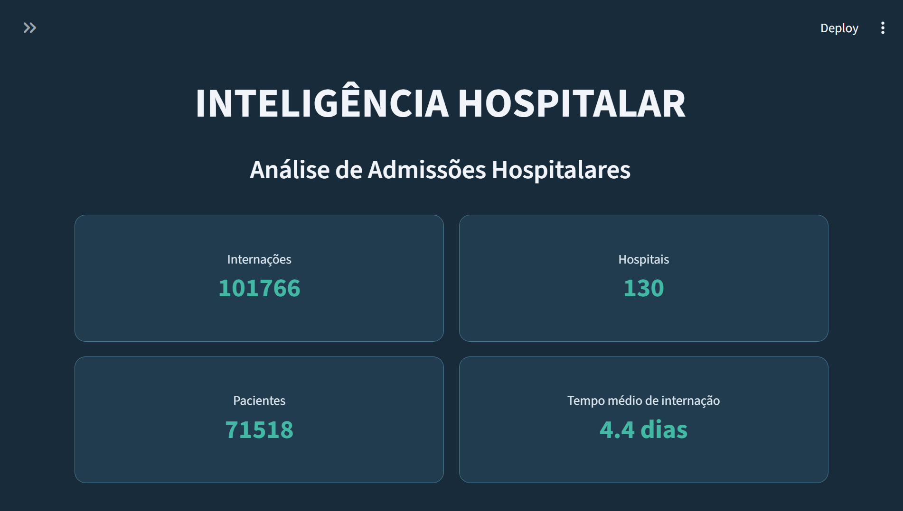
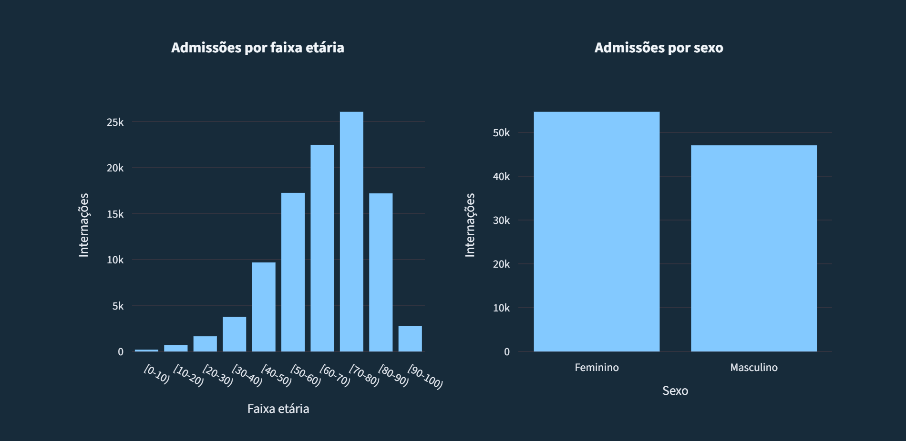
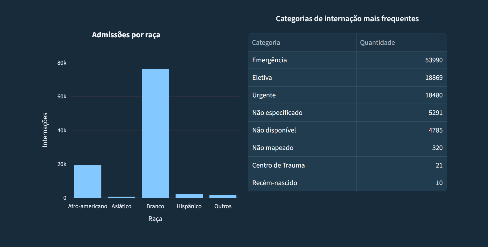
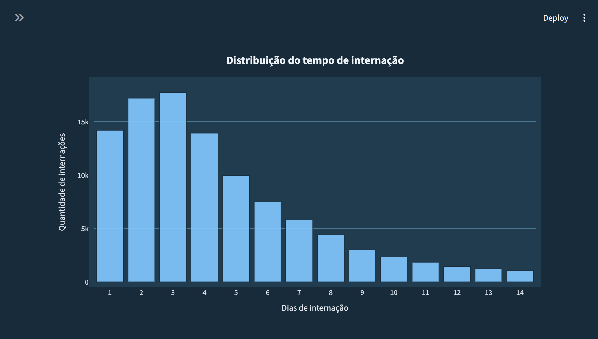
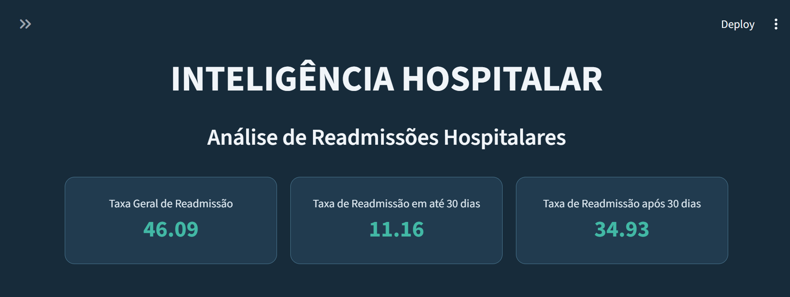
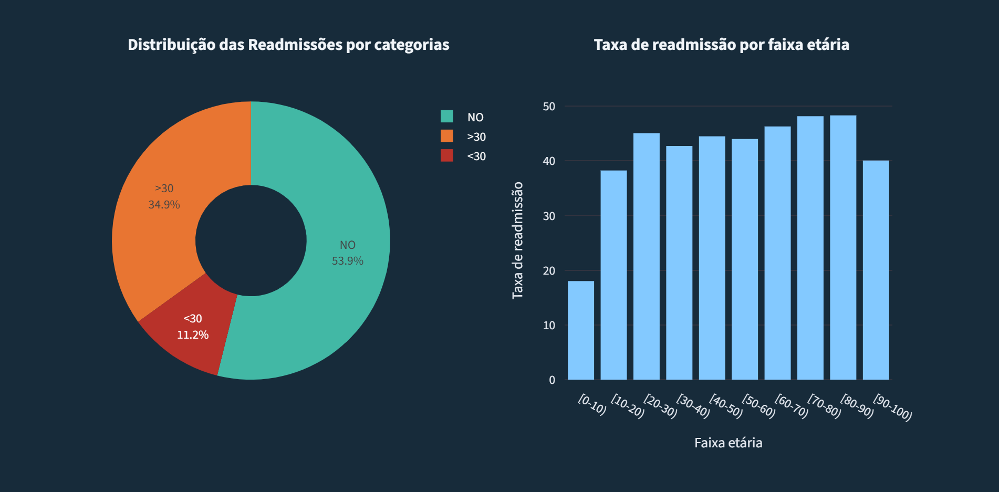
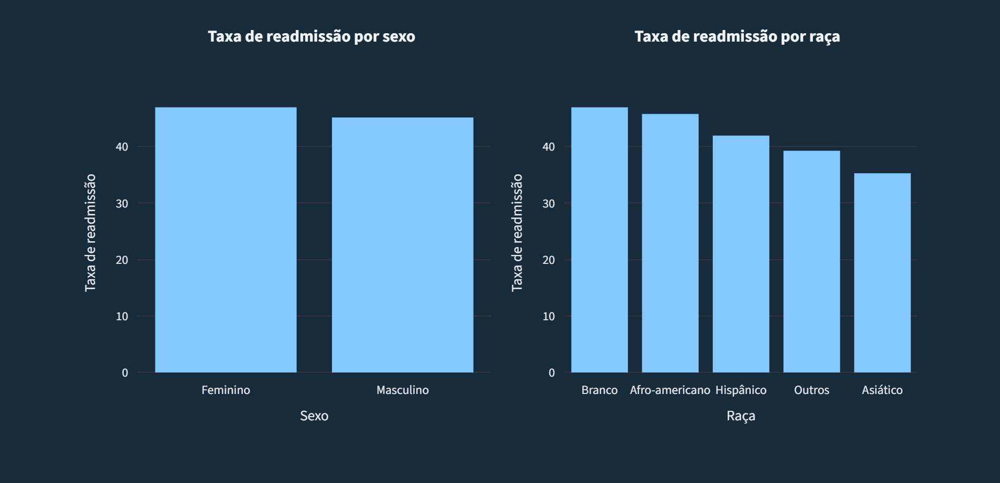
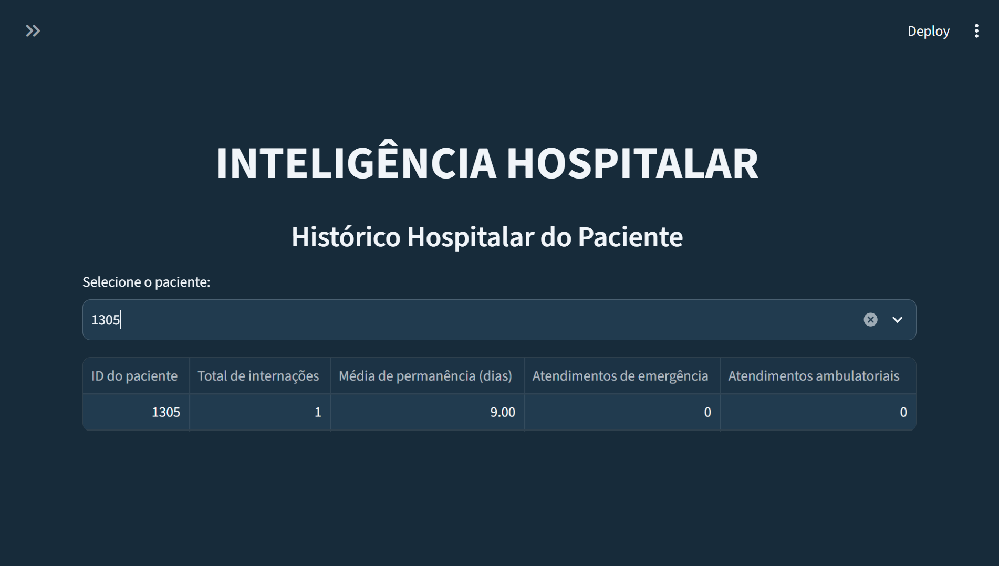

# Projeto de Inteligência Hospitalar - Análise de Admissões em 130 Hospitais

## Objetivo

Este projeto tem como objetivo desenvolver um estudo de caso utilizando o conjunto de dados [Diabetes 130-US Hospitals for Years 1999-2008](https://www.kaggle.com/datasets/sulphatet/diabetes-130us-hospitals-for-years-19992008), disponibilizado no Kaggle.

A proposta consiste em explorar os dados hospitalares relacionados a pacientes com diabetes, identificar padrões e extrair informações relevantes sobre internações e readmissões hospitalares.

O projeto está dividido em seis etapas:

1. ETL (Extração, Transformação e Carga) dos dados;
2. Análise exploratória utilizando Pandas e Matplotlib;
3. Consultas e extração de informações com SQL e PostgreSQL;
4. Modelagem de dados em estruturas relacionais e dimensionais;
5. Desenvolvimento de um pipeline de integração e alimentação de um sistema inteligente;
6. Elaboração de um dashboard para visualização dos indicadores identificados.

## Metodologia

### 1. ETL dos dados

Extração, transformação e limpeza do conjunto de dados, incluindo o tratamento de valores ausentes, duplicidades e inconsistências.
Após a preparação, os dados foram carregados em uma tabela denominada `readmissoes_diabetes`, armazenada no banco de dados `inteligencia_hospitalar`, utilizando PostgreSQL.

Mais informações:

- [Notebook de análise exploratória](notebooks/analise_exploratoria.ipynb)
- [Scripts do projeto](src/)

### 2. Análise exploratória

Obtenção de informações registradas na base de dados, criação de gráficos e outros visuais e manipulação de indicadores, utilizando as bibliotecas Pandas e Matplotlib.

Mais informações:

- [Notebook de análise exploratória](notebooks/analise_exploratoria.ipynb)
- [Scripts do projeto](src/analysis)

### 3. Consultas SQL

Realização de consultas SQL utilizando funções (COUNT, AVG, MAX, COALESCE, ROUND, WHERE, GROUP BY, ORDER BY, LIMIT, FILTER), CTEs, sub-consultas para encontrar informações como:

- Quantidade total de internações;
- Quantidade de pacientes;
- Tempo médio de internação;
- Taxa geral de readmissão;
- Histórico hospitalar de um paciente.

Mais informações:

- [Consultas SQL realizadas com auxílio das bibliotecas Pandas e SQLAlchemy](sql/queries.py)

### 4. Modelagem de dados

Foram realizadas dois tipos de modelagem de banco de dados: relacional e dimensional.

- Relacional: Estruturação de tabelas com chaves primárias e estrangeiras, estabelecendo relacionamentos entre as entidades. O modelo armazena informações sobre pacientes, medições, exames, medicamentos e internações. O diagrama e o modelo físico podem ser consultados em [Modelo relacional](modelagem/relacional/).
- Dimensional: Desenvolvimento de um modelo baseado em Star Schema, composto por tabelas fato, que representam os processos analisados (administração de medicamentos, exames e internações), e tabelas dimensão, que armazenam características descritivas dos pacientes e dos processos. A modelagem pode ser consultada em [Modelo Dimensional](modelagem/dimensional/).

### 5. Pipeline de Dados

Após as etapas de coleta e tratamento, os dados são armazenados em um banco de dados relacional, que serve como fonte de alimentação para o sistema de análise hospitalar. As consultas SQL são responsáveis pela extração e agregação das informações utilizadas na construção dos indicadores e das visualizações do dashboard.

Os scripts responsáveis por essas etapas estão disponíveis nos arquivos [Conexão com o Banco de Dados](dashboard/database.py) e [Extração de Informações](dashboard/queries.py).

### 6. Dashboard

O sistema desenvolvido é composto por três páginas principais:

1. **Análise das Admissões Hospitalares:** apresenta indicadores e visualizações sobre as internações hospitalares, considerando dimensões como gênero, raça, faixa etária, categorias de admissão e tempo de permanência hospitalar.

2. **Análise das Readmissões:** apresenta indicadores e taxas de readmissão hospitalar, permitindo analisar a distribuição das readmissões e comparar sua ocorrência entre diferentes grupos demográficos, como faixa etária, gênero e raça.

3. **Histórico Hospitalar do Paciente:** permite consultar um resumo do histórico de internações de um paciente a partir de seu identificador, apresentando informações como quantidade de internações, tempo médio de permanência e registros de atendimentos emergenciais e ambulatoriais.

















## Tecnologias Aplicadas

- Pandas e Numpy: utilizadas para extração, coleta e tratamento dos dados para análise;
- Matplotlib: empregada para disponibilizar gráficos estáticos;
- SQLAlchemy e Psycopg2-binary: aplicadas para obter conexão com o banco de dados PostgreSQL;
- Streamlit: utilizada para criar um painel de visualizações de dados na web;
- Plotly: empregada para representar gráficos e visualizações dinâmicas;
- Python-dotenv e dotenv: aplicadas para gerenciar acesso a variáveis de ambiente.

## Estrutura do Projeto

```text
inteligencia-hospitalar/
│
├── dashboard/
│   ├── pages/
│   │   ├── Admissoes.py
│   │   ├── Readmissoes.py
│   │   └── Historico_Paciente.py
│   │
|   ├── .streamlit/
│   │   └── config.toml
|   |
│   ├── app.py
│   ├── database.py
│   └── queries.py
│
├── data/
│   ├── processed/
|       └── diabetic_data.csv
│
|   ├── raw/
|       └── diabetic_data.csv
|       └── IDs_mapping.csv
|
├── modelagem/
|   ├── dimensional/
|       └── dimensional.sql
|       └── dimensional.png
|
|   ├── relacional/
|       └── relacional.sql
|       └── relacional.png
|
├── notebooks/
│   └── analise_exploratoria.ipynb
│
├── sql/
|   └── database.py
|   └── queries.py
|
├── src/
|   └── database.py
|   └── extract.py
|   └── load.py
|   └── main.py
|   └── transform.py
|
├── visualizations/
|
├── .env
├── .env.example
├── .gitignore
├── README.md
└── requirements.txt
```

## Como Executar

### Instalação de Dependências

1. Verifique se seu dispositivo possui Python instalado:

   ```bash
   python --version
   ```

Caso não possua, instale o Python em: [Instalador](https://www.python.org/downloads/).

2. Instale as dependências:

```bash
   python -m pip install -r requirements.txt
```

OU

```bash
   pip install -r requirements.txt
```

### ETL (Extract, Transform, Load)

1. Realize o download dos conjuntos de dados em .CSV em: [Diabetes 130-US Hospitals for Years 1999-2008](https://www.kaggle.com/datasets/sulphatet/diabetes-130us-hospitals-for-years-19992008);

2. Armazene os conjuntos de dados em [data/raw](data/raw);

3. Utilizando o PostgreSQL, crie um banco de dados por meio do pgAdmin ou DBeaver.

4. Copie o arquivo .env.example e renomeie a cópia para .env;

5. Preencha o arquivo .env com as credenciais de acesso ao banco de dados, conforme as variáveis especificadas no arquivo .env.example;

6. Execute o arquivo [src/main.py](src/main.py) para iniciar o processo ETL. Ao final da execução, haverá um arquivo em [data/processed/](data/processed/) e uma tabela chamada readmissoes_diabetes no banco de dados criado.

### Análise Exploratória

Os resultados da análise exploratória podem ser visualizados em [Notebook de Análise Exploratória](notebooks/analise_exploratoria.ipynb), os scripts podem ser encontrados em [Scripts](src/analysis/) e as representações gráficas podem ser resgatadas em [Visualizações](visualizations/).

### Consultas SQL

1. Execute o arquivo [Script de Consultas](sql/queries.py) para visualizar os resultados das consultas feitas.

### Modelagens Dimensional e Relacional

1. Os modelos físicos podem ser executados através da importação em um SGBD dos arquivos SQL disponíveis em [Scripts SQL Dimensional](modelagem/dimensional/dimensional.sql) e [Scripts SQL Relacional](modelagem/relacional/relacional.sql);
2. Os modelos gráficos podem ser visualizados também acessando a pasta [Modelagem Relacional](modelagem/relacional/) e [Modelagem Dimensional](modelagem/dimensional/).

### Dashboard

1. Para visualizar e navegar pelo painel desenvolvido, execute o seguinte comando no terminal, a partir do diretório raiz do projeto:

   ```bash
   streamlit run dashboard/app.py
   ```
